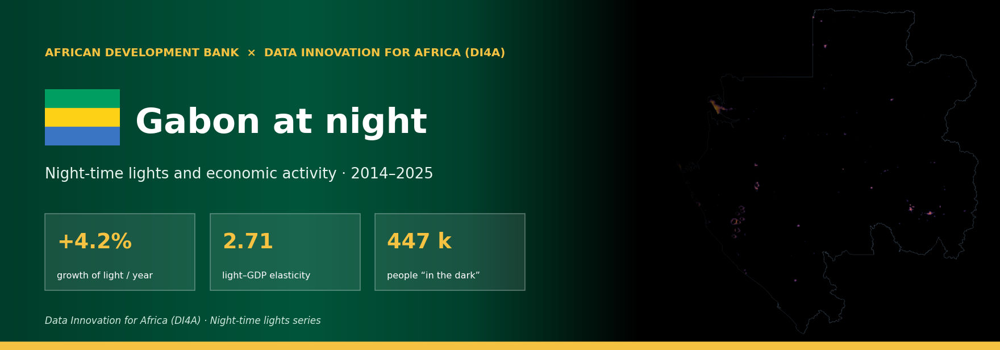
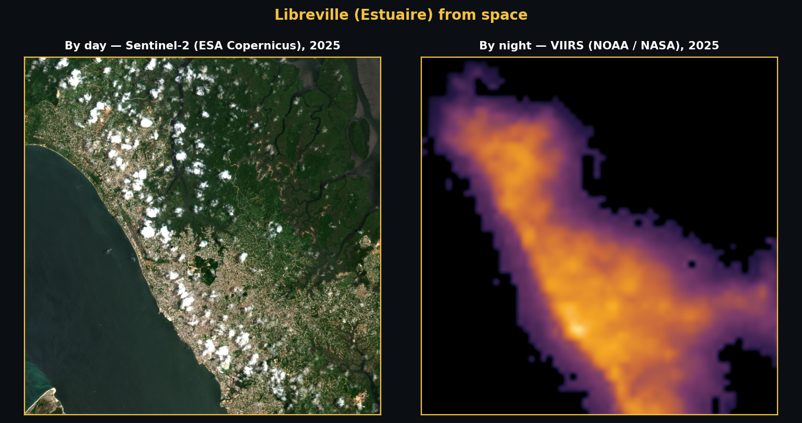
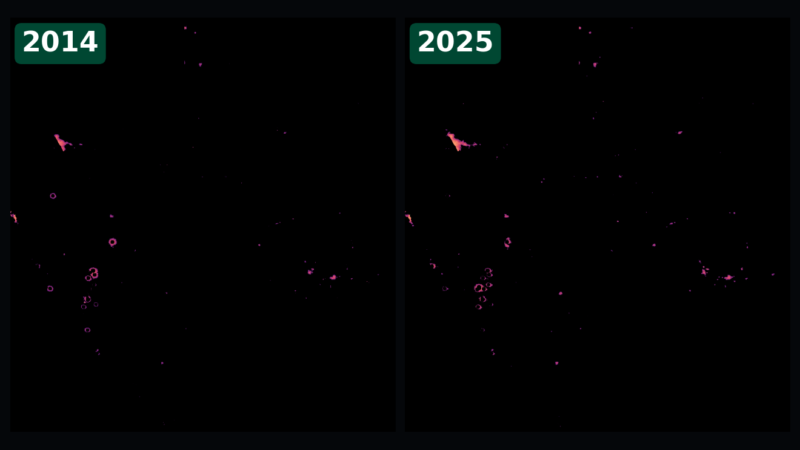
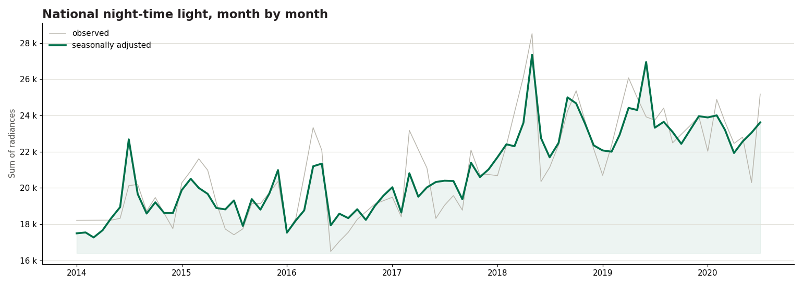
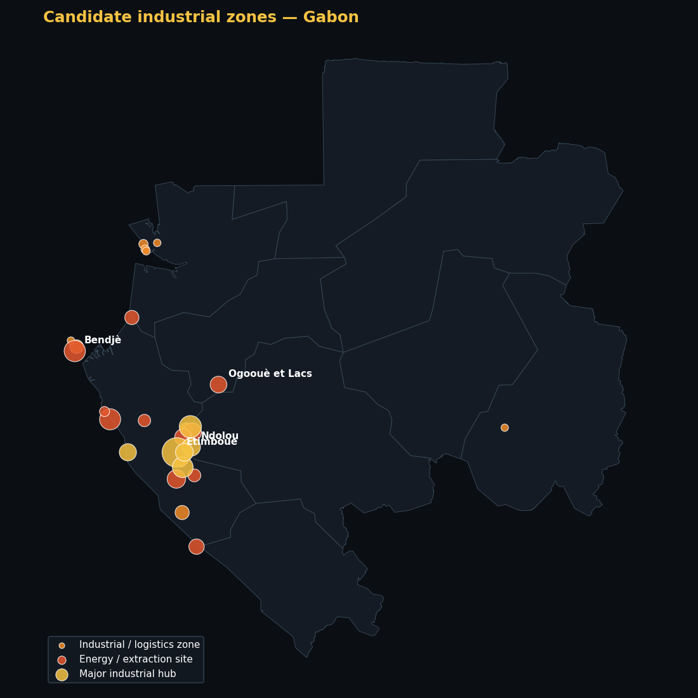
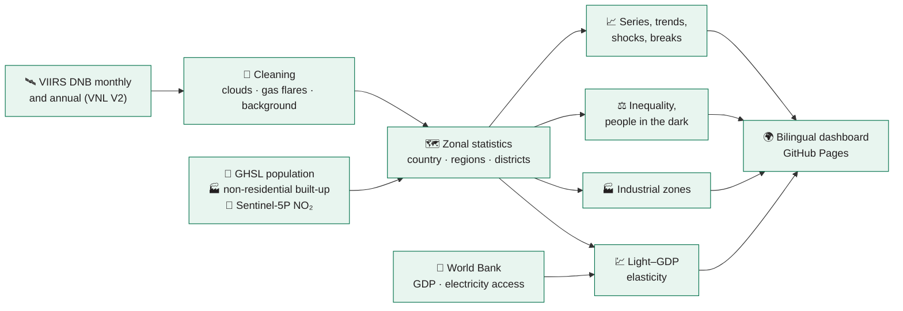

<!-- ntl-dashboard:auto — generated by the night-time lights notebook (part 3); edits will be overwritten -->

<b><a href="https://asrodelgo.github.io/ntl-dashboard/">🌍 Dashboard</a> &nbsp;·&nbsp; <a href="https://asrodelgo.github.io/ntl-dashboard/#map">🗺️ Map</a> &nbsp;·&nbsp; <a href="https://asrodelgo.github.io/ntl-dashboard/#time">📈 Trends</a> &nbsp;·&nbsp; <a href="https://asrodelgo.github.io/ntl-dashboard/#industry">🏭 Industrial zones</a> &nbsp;·&nbsp; <a href="https://asrodelgo.github.io/ntl-dashboard/#method">📐 Method</a> &nbsp;·&nbsp; <a href="https://asrodelgo.github.io/ntl-dashboard/#data">⬇️ Data</a> &nbsp;·&nbsp; <a href="README.fr.md">🌐 Français</a></b>

     

> [!NOTE]
> This repository hosts the **public dashboard** of economic activity in **Gabon** measured with night-time lights seen from space (2014–2025). The site is bilingual (English / French), fully static and regenerated each time the notebook runs.

## 📊 Key figures

<table>
<tr>
<td align="center" width="33%">📈 Annual growth of light <h3>+4.2%</h3>2014–2025, robust slope (Theil–Sen)</td>
<td align="center" width="33%">🗓️ Last 12 months vs previous 12 <h3>-1.9%</h3>seasonally adjusted series, up to 07/2020</td>
<td align="center" width="33%">💹 Light–GDP elasticity <h3>2.71</h3>95% CI 1.92 to 3.50 · confidence medium</td>
</tr>
<tr>
<td align="center" width="33%">⚖️ Gini of light per capita <h3>0.49</h3>ADM2 units, 2025</td>
<td align="center" width="33%">🌑 People in the dark <h3>447 k</h3>18% of the inhabited population, 2025</td>
<td align="center" width="33%">🏙️ Share of the top region <h3>51%</h3>Estuaire, 2025</td>
</tr>
</table>

## 💡 Key messages

1. **National trend** — Between 2014 and 2025, night-time light in Gabon changed by +4.2% per year (95% CI: +3.0% to +5.6%). Over the last 12 months, the seasonally adjusted level is -1.9% relative to the previous 12 months.  
   🟢 high · significant trend (p < 0.01; n = 12)
2. **Regions** — Of 49 ADM2 units, 15 show significant growth, 24 are stagnating and 1 are declining. Light remains concentrated: Estuaire accounts for 51% of national light.  
   🟠 medium · classification of 49 units, threshold ±1%/yr and p < 0.10
3. **Convergence** — Across ADM2 units, light per capita shows neither statistically established convergence nor divergence.  
   🔴 low · β = −0.000 [−0.016; 0.015], n = 36
4. **Link with GDP** — The elasticity of light with respect to real GDP is 2.71 in levels (95% CI: 1.92 to 3.50, R² = 0.88, 12 years) and 1.38 in growth rates (CI: −1.14 to 3.90).   
   🟠 medium · n = 12, significant but wide CI (1.58)
5. **Shocks** — The most pronounced shock in the seasonally adjusted series is “COVID-19”: trough of -8.0% (04/2020), no return to the pre-shock level by the end of the data.  
   🔴 low · trough compared with pre-shock month-to-month variability
6. **Inequality and access** — The Gini coefficient of light per capita (ADM2) is 0.49 in 2025 (no significant change since 2014). About 0.45 million people live in inhabited areas with no detectable light (18% of the inhabited population).  
   🟠 medium · sensitive to the radiance threshold (from 0.00 to 0.47 M depending on the threshold); a proxy for outdoor lighting, not for grid connection
7. **Industrial zones** — 27 candidate industrial zones are detected (6 major hubs, 12 energy sites), covering 258 km². They emit 58% of national light; the largest is Etimbouè (Ogooué-Maritime). Their light changes by +0.0% per year.  
   🟠 medium · 78% of zones confirmed by OpenStreetMap; candidates to be checked

## 🛰️ Day and night

The country's main economic pole (Libreville (Estuaire)), by day as seen by Sentinel-2 and by night as seen by VIIRS. What the satellite sees at night — the lighting of cities, ports, factories and roads — is the proxy of activity used throughout this project.

## 🌃 What changed

VIIRS VNL V2 annual composites (gas flares masked), same logarithmic scale: left 2014, right 2025.

## 📈 The trend

The seasonally adjusted curve removes seasonal effects (snow, vegetation, festivities): read it to judge a rise or a fall.

## 🏭 Industrial zones

Industrial sites shine at night like towns, but their buildings are mostly non-residential, few people live there and they emit NO₂. Combining VIIRS, GHSL (non-residential built-up, population) and Sentinel-5P, **27 candidate zones** are detected; they emit **58%** of national light. 78% of them contain an industrial area mapped in OpenStreetMap (± 1 km).

| # | Zone | Type | Area | Share of national light | Growth / yr |
|---:|---|---|---:|---:|---:|
| 1 | Etimbouè (Ogooué-Maritime) | Major industrial hub | 54.0 km² | 18.8% | +11.7% |
| 2 | Etimbouè (Ogooué-Maritime) | Major industrial hub | 27.6 km² | 5.7% | -0.5% |
| 3 | Bendjè (Ogooué-Maritime) | Energy / extraction site | 15.6 km² | 4.7% | -4.4% |
| 4 | Etimbouè (Ogooué-Maritime) | Energy / extraction site | 9.8 km² | 4.5% | +8.0% |
| 5 | Etimbouè (Ogooué-Maritime) | Major industrial hub | 20.3 km² | 4.2% | -3.8% |
| 6 | Etimbouè (Ogooué-Maritime) | Energy / extraction site | 17.3 km² | 2.7% | -2.3% |
| 7 | Etimbouè (Ogooué-Maritime) | Energy / extraction site | 4.1 km² | 2.5% | -9.2% |
| 8 | Ndolou (Ngounié) | Major industrial hub | 16.0 km² | 2.4% | +15.7% |

## 🧭 What the dashboard contains

| Page | What you will find |
|---|---|
| [**Overview**](https://asrodelgo.github.io/ntl-dashboard/#overview) | key figures, automatically generated messages with their confidence level |
| [**Map**](https://asrodelgo.github.io/ntl-dashboard/#map) | light year by year, change, regional statistics on hover |
| [**Trends**](https://asrodelgo.github.io/ntl-dashboard/#time) | observed and seasonally adjusted monthly series, year-on-year change, long series 1992 → |
| [**Regions**](https://asrodelgo.github.io/ntl-dashboard/#regions) | growth by region and district, classes, concentration and convergence |
| [**Shocks**](https://asrodelgo.github.io/ntl-dashboard/#shocks) | COVID-19 and other events: trough, recovery, placebo test, daily index |
| [**Inequality**](https://asrodelgo.github.io/ntl-dashboard/#inequality) | Gini, Lorenz curves, Theil, people “in the dark” |
| [**Industrial zones**](https://asrodelgo.github.io/ntl-dashboard/#industry) | candidate zones, score, trend, OpenStreetMap validation |
| [**Method & limitations**](https://asrodelgo.github.io/ntl-dashboard/#method) | sources, parameters, assumptions and known biases |
| [**Data**](https://asrodelgo.github.io/ntl-dashboard/#data) | every downloadable table, reproducibility manifest |

## ⚙️ How it is computed

Processing chain run on Google Earth Engine from the *Night-time lights and economic activity* notebook (part 3):

<b>The six analyses in detail</b>

| | |
|---|---|
| **📈 Time dynamics** | STL decomposition, year-on-year change, Theil–Sen trend with Mann–Kendall test, anomalies, breaks |
| **🗺️ Regional growth** | Growth / Stagnation / Decline classes (Benjamini–Hochberg correction), HHI, β and σ convergence |
| **💹 Lights and GDP** | elasticity (HAC errors, bootstrap), nowcast judged against two naive forecasts, experimental regional GDP |
| **⚡ Shocks** | trough, gap vs trend, months to recovery, placebo test, Black Marble daily index |
| **⚖️ Inequality and access** | Gini, Theil (between / within regions), urban / rural ratio, people in the dark at three thresholds |
| **🏭 Industrial zones** | four-signal score (light, non-residential built-up, low density, NO₂), OpenStreetMap validation |

## ⚠️ Limitations to keep in mind

> [!IMPORTANT]
> Lights measure radiance at about 1:30 a.m., not value added. Keep in mind:
>
> - **Blooming and saturation** — light spills beyond built-up areas; the brightest cores plateau
> - **Gas flares** — bright without local activity: masked, but worth watching
> - **Seasonality** — clouds, fires and vegetation create non-economic cycles
> - **Sensor breaks** — DMSP → VIIRS, VNL V2.1 → V2.2: handled with dummies, not eliminated
> - **Rural areas** — the signal is weakest where the rural poor live
> - **Status** — experimental estimates, not official statistics

## ⬇️ Download the data

| File | Content |
|---|---|
| [`monthly_national.csv`](https://asrodelgo.github.io/ntl-dashboard/data/GAB/monthly_national.csv) | national monthly series: observed, seasonally adjusted, trend, anomalies |
| [`annual_units.csv`](https://asrodelgo.github.io/ntl-dashboard/data/GAB/annual_units.csv) | one row per unit and year: light, population, light per capita, people in the dark |
| [`regions.csv`](https://asrodelgo.github.io/ntl-dashboard/data/GAB/regions.csv) | latest-year indicators by region and district (map, ranking) |
| [`gdp.json`](https://asrodelgo.github.io/ntl-dashboard/data/GAB/gdp.json) | light–GDP elasticity, nowcast, experimental regional GDP |
| [`shocks.json`](https://asrodelgo.github.io/ntl-dashboard/data/GAB/shocks.json) | events, troughs, recovery, breaks, anomalies, daily indices |
| [`inequality.json`](https://asrodelgo.github.io/ntl-dashboard/data/GAB/inequality.json) | Gini, Lorenz, Theil, people in the dark and threshold sensitivity |
| [`industrial.geojson`](https://asrodelgo.github.io/ntl-dashboard/data/GAB/industrial.geojson) | candidate industrial zones (geometries and indicators) |
| [`meta.json`](https://asrodelgo.github.io/ntl-dashboard/data/GAB/meta.json) | parameters, software versions, dataset availability: reproducibility |

📁 [`gh-pages/data/GAB/`](https://github.com/asRodelgo/ntl-dashboard/tree/gh-pages/data/GAB)

## 📚 Data and licences

| Dataset | Producer | Licence |
|---|---|---|
| VIIRS DNB VNL V2 and monthly VCMSLCFG | NOAA / Earth Observation Group | public domain, citation requested |
| NASA Black Marble VNP46A2 | NASA | public domain |
| GHSL GHS-POP, GHS-BUILT-S, GHS-SMOD R2023A | European Commission, JRC | CC BY 4.0 |
| Sentinel-2 L2A, Sentinel-5P TROPOMI NO₂ | ESA / Copernicus | Copernicus licence (free) |
| geoBoundaries administrative boundaries | William & Mary geoLab | CC BY 4.0 |
| World Development Indicators | World Bank | CC BY 4.0 |
| Industrial areas (validation) | OpenStreetMap | ODbL |

## 🗂️ Repository layout

- `main` — this page: presentation, illustrations (`docs/img/`), licence, citation
- `gh-pages` — the published site: `index.html`, `assets/`, `data/<ISO3>/` (every table downloadable), French version in `fr/`

## 🔁 Reproduce or adapt to another country

The site is produced by the **Night-time lights and economic activity** notebook (part 3) (Colab). Changing the `ISO3` code in the parameters cell is enough to analyse another country; sections 12 and 13 export and re-publish this repository.

## 🤝 Credits and citation

Produced by the **African Development Bank** as part of **Data Innovation for Africa (DI4A)**. Estimates are experimental and are not official statistics.

**Licence** — content CC BY 4.0, code MIT (see `LICENSE`). Any reuse must cite: **Source: African Development Bank – Data Innovation for Africa (AfDB-DI4A)**.

**Suggested citation**

> African Development Bank — Data Innovation for Africa (DI4A) (2026). *Night-time lights and economic activity · 2014–2025 — Gabon*. https://asrodelgo.github.io/ntl-dashboard/

---

© 2026 AfDB-DI4A · Any reuse must cite “Source: AfDB-DI4A”

Last update: 2026-11-19 · <a href="#top">↑</a>

